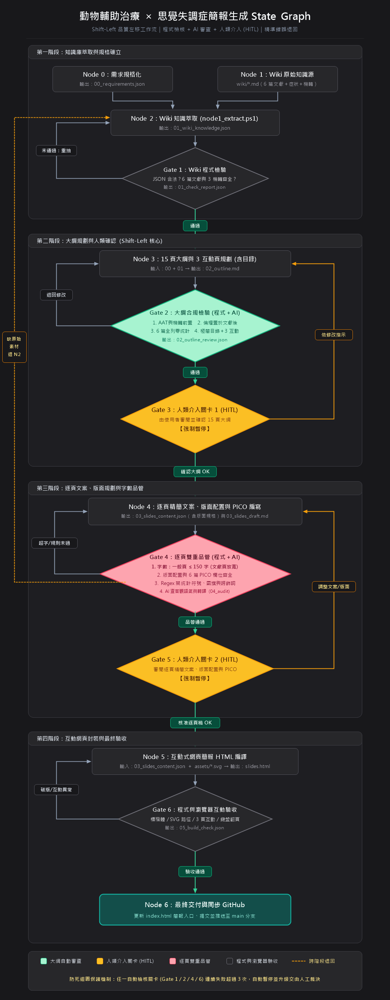
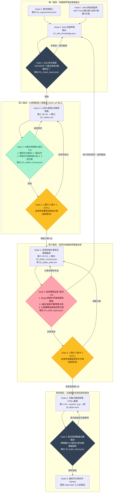

# 簡報生成 State Graph 系統架構 (`graph/`)

本目錄實作基於 **LLM Wiki (`wiki/`)** 之**四階段狀態圖（State Graph）簡報生成工作流**，採用 **Shift-Left（品質左移）** 策略，在大綱與逐頁稿階段即透過「程式檢核 ＋ AI 審查 ＋ 人類確認（HITL）」層層把關，再進入互動網頁渲染。

---

## 1. 四階段 State Graph 完整長圖

*(原始向量檔：[slide_generation_graph.svg](slide_generation_graph.svg)｜產生腳本：[scripts/render_graph_png.ps1](scripts/render_graph_png.ps1))*

展開 Mermaid 原始碼

> **防死迴圈保護（Escalation）**：任一自動化關卡（Gate 1 / Gate 2 / Gate 4 / Gate 6）連續退回超過 **3 次（`max_retries = 3`）**，流程即自動暫停並升級交由人工裁決。

---

## 2. 狀態檔案與檢查對照表 (`graph/state/`)

| 階段 | 節點 / 關卡 | 輸入檔案 | 輸出檔案 | 檢查方式 | 失敗退回目標 |
| :--- | :--- | :--- | :--- | :--- | :--- |
| **第一階段** | Node 0 / 1 / 2 + Gate 1 | `wiki/**/*.md` | `00_requirements.json` `01_wiki_knowledge.json` `01_check_report.json` | 程式驗證 (`check_node1.ps1`) | 退回 Node 2 |
| **第二階段** | Node 3 + Gate 2 / Gate 3 | `00` + `01` | `02_outline.md` `02_outline_review.json` | 程式＋AI (`check_node2.ps1`) **人類介入關卡 1 (強制)** | 退回 Node 3 |
| **第三階段** | Node 4 + Gate 4 / Gate 5 | `02` + `01` | `03_slides_content.json` `03_slides_draft.md` `04_audit_report.json` | 程式 Regex ＋ AI 語意審查 **人類介入關卡 2 (強制)** | 文案錯退回 Node 4 缺素材退回 Node 2 |
| **第四階段** | Node 5 / 6 + Gate 6 | `03` + `assets/*.svg` | `slides.html` `05_build_check.json` | 程式檢核 ＋ 瀏覽器人工驗收 | 僅退回 Node 5 |
