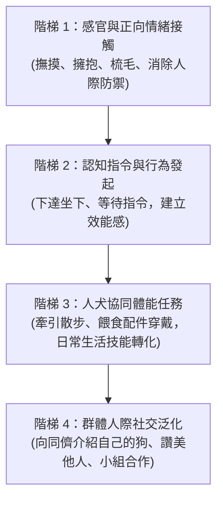

# 社交鷹架與動機外接催化 (Social Scaffolding)

> [!SUMMARY] 一句話精華
> 解釋動物如何作為職能復健中之中介媒介（Intermediary Medium），透過提供非評判性的安全支撐（鷹架），協助個案逐步重建人際互動與自主行動技能的心理社會學機轉。

---

## 1. 理論基礎與核心概念
- **社交鷹架 (Scaffolding) 原理**：
  - 借鏡發展心理學家維高斯基（Vygotsky）之「近側發展區 (ZPD)」概念。慢性精神疾患個案因長年發病與機構化生活，直接面對複雜的人類社交要求時往往會產生「社交癱瘓」與逃避。
  - 動物在人際互動中扮演了**暫時性但堅固的安全鷹架**：牠降低了互動的認知與情感負荷，讓個案能在低威脅情境下練習「主動性」、「責任感」與「雙向溝通」。
- **動機外接啟動馬達 (External Motivational Catalyst)**：
  - 當個案內在驅動力（[[avolition|動機缺乏]]）嚴重受損時，動物主動尋求接觸的特質（如搖尾、嗅聞、討摸）提供了外部強烈的情境線索，外接帶動個案的肢體與情感反應。

---

## 2. 臨床實務模型：台灣長庚／台大四階鷹架架構
在 [[2021-chen-dog-aat-taiwan-rct]] 的 12 週 RCT 中，職能治療團隊設計了層次分明的四階鷹架模型，展現了社交鷹架的標準操作：

---

## 3. 實證數據支持
- **出席率與參與度**：在 [[2021-chen-dog-aat-taiwan-rct]] 中，此種結構化鷹架支持達成了 **0% 脫落率**；[[2016-calvo-dog-aat-rehab-rct]] 亦記錄到高達 92.9% 的復健出席率。
- **症狀改善**：透過鷹架的逐步引導，個案在 [[panss-negative]] 上的社交退縮（N4）與情感平淡（N1）評分顯著降低。

---

## 4. 🌟 臨床實務與日常生活／大眾生活功能意涵 (Public & Daily Life Meaning)

> **大眾與家屬視角解讀**：
> 蓋房子需要鷹架，等牆壁穩固了，鷹架才會拆除；復健也是同樣的道理。
> 
> 如果我們直接把一個長年躲在房裡的思覺失調個案推進熱鬧的聚會或要求他去面試，這就像在沒有鷹架的情況下要求一個骨折未癒的人去跑馬拉松，只會帶來恐慌與挫敗。
> 
> 治療犬就是這座最溫柔的「心理鷹架」：
> 1. 第一步，個案只需要坐著摸摸狗，不需要說一句話，先感受安全。
> 2. 第二步，治療師鼓勵個案說一聲「坐下」，當狗狗聽話坐下時，個案體驗到「原來我能掌控事物、我有影響力」。
> 3. 第三步，個案牽著狗狗在教室走一圈，接受身旁病友的掌聲。
> 4. 最後，個案開始主動對旁邊的人說：「你的狗剛才好厲害喔！」
> 
> 當這段鷹架一步步搭建完成，個案被封閉在內心的自信與勇氣也就慢慢長了出來，最終能脫離鷹架，獨立面對生活中的真實人際。
