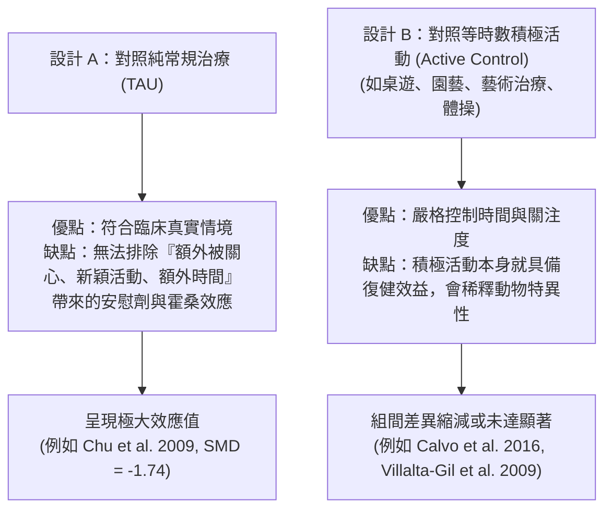

# 積極對照組設置難題：休閒活動 vs 動物特異性療效之區分限制

> [!SUMMARY] 一句話精華
> 探討動物輔助治療（AAT）臨床試驗中最核心的方法學挑戰：對照組究竟該設置為純「常規治療 (TAU)」，還是等時數的「非動物積極休閒活動」？此設計直接左右了統計效應值的大小與結論解讀。

---

## 1. 核心方法學困境 (The Dilemma)

在評估 AAT 對思覺失調負性症狀的成效時，研究者面臨經典的兩難抉擇：

---

## 2. 跨文獻實證對比 (Literature Evidence)

1. **純 TAU 對照組研究**：
   - Chu et al. (2009)：對照常規治療，AAT 組負性症狀改善達 $\text{SMD} = -1.74$。
2. **高標準積極對照組研究**：
   - [[2021-chen-dog-aat-taiwan-rct]]：對照組每週額外接受 1 小時護理與職能治療，成功在嚴格條件下證明犬類介入具備超越常規復健的特異效應（$SRD = 0.50, p < 0.001$）。
   - [[2016-calvo-dog-aat-rehab-rct]]：對照組接受等時數之美術、體操活動，兩組在正性與一般病理均有改善，使組間在 PANSS 總分上未達統計顯著。
   - [[2026-peraile-huerta-aat-psychosis-meta]] 統合分析：指出研究間的對照組異質性是導致統計異質性（$I^2$）上升的主要來源。

---

## 3. 🌟 臨床實務與日常生活／大眾生活功能意涵 (Public & Daily Life Meaning)

> **大眾與家屬視角解讀**：
> 「有些學者說：『如果陪病人玩桌遊或做勞作也有進步，為什麼一定要找狗來？』」
> 
> 這是一個常被提出來挑戰動輔治療的質疑。然而，臨床真實世界告訴我們：
> 1. **「願意走進教室」才是關鍵前提**：做手工藝或玩桌遊確實也有好處，但前提是病人要「願意來」。對於重度冷漠、動機缺乏的個案，叫他做手工藝他往往轉頭拒絕（常規復健出席率僅約 60%）；但聽說有狗狗在等他，出席率直接飆到 93%（[[2016-calvo-dog-aat-rehab-rct]]）。
> 2. **動物是啟動活動的「超強引信」**：動物特異性不只體現在「做完後的量表分數」，更體現在「能讓原本一動也不動的人願意開始行動」。動物不是取代其他活動，而是讓所有後續的生活復健成為可能的催化起點。
