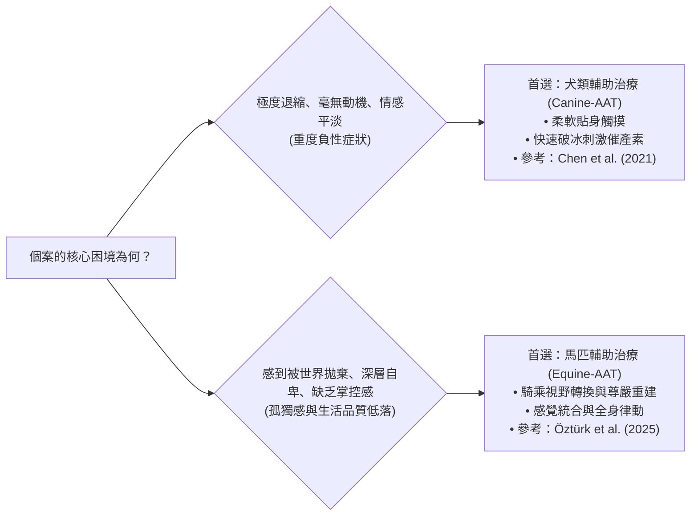

---
title: 從封閉孤立到溫柔破冰：動物如何走入思覺失調個案的日常（大眾科普與去污名化綜述）
category: synthesis
tags: [synthesis, public-science, de-stigmatization, daily-life, family-education, recovery]
last_updated: 2026-11-17
---

# 從封閉孤立到溫柔破冰：動物如何走入思覺失調個案的日常

> [!SUMMARY] 一句話精華
> 走出醫學專有名詞的象牙塔，全面解讀「負性症狀」對個案與家庭造成的隱形枷鎖，並透過科學實證揭示治療犬與治療馬如何作為無評判的溫暖橋樑，重燃生活希望。

---

## 序言：看不見的真正困境——什麼是「負性症狀」？

當社會大眾談論起「思覺失調症（舊稱精神分裂症）」時，腦海中浮現的往往是電影戲劇裡的刻板印象：幻聽、妄想、語無倫次、情緒失控。這些在精神醫學上被稱為**「正性症狀（Positive Symptoms）」**——多出來的異常知覺。

現代精神藥物對壓制幻覺與妄想已經非常成熟。然而，真正把個案與社會徹底隔絕、讓無數家庭陷入漫長痛苦的，往往是那些「被偷走的能力」——醫學上稱為**「負性症狀（Negative Symptoms）」**：

- **動機被偷走了 ([[avolition|動機缺乏]])**：連起床、洗臉、換衣服都顯得千斤沉重，整日坐在客廳或躺在床上發呆。
- **表情被偷走了 ([[blunted-affect|情感平淡]])**：眼神空洞，嘴角不再揚起，無論周遭發生什麼悲喜事件，臉部如石雕般僵硬。
- **快樂被偷走了 ([[anhedonia|無快感症]])**：吃喜歡的美食不再感到美味，過去熱愛的嗜好變得毫無吸引力。
- **語言與人際被偷走了 ([[asociality|社交退縮]] / [[alogia|言語貧乏]])**：害怕人群，害怕被批判，問一句答半句，漸漸退縮到無人的角落。

在日常生活中，家屬常因不理解而痛心地責怪：「你怎麼變得這麼懶？」「你就不能稍微努力一點走出來嗎？」這種誤解造成了深層的二次傷害，也讓個案在自卑與自責中越陷越深。

---

## 第一章：科學的重大突破——動物不是娛樂，而是有實證的醫療輔助

長期以來，精神醫學界對負性症狀近乎束手無策，因為傳統藥物對活化動機的效果相當有限。

然而，在 **[[2026-peraile-huerta-aat-psychosis-meta|2026 年發表的最新大型統合分析 (Meta-Analysis)]]** 中，國際研究團隊彙整了 12 項研究、408 位個案的臨床數據，證實了震撼的結論：
> **動物輔助治療（AAT）對思覺失調症的負性症狀，能產生統計上中等程度的實質改善（SMD = -0.51, p < 0.05）**。

這項統合分析告訴社會：**帶動物進入精神復健，絕對不是單純的「讓病人摸摸狗、消磨時間的娛樂」，而是一種能精準穿透藥物死角、喚醒大腦社交網絡的循證醫學介入**。

---

## 第二章：毛茸茸的奇蹟——為什麼動物能做到人類做不到的事？

為什麼經驗豐富的醫師、心理師或深愛個案的家人苦口婆心勸說無效，一隻狗狗卻能在幾十分鐘內打開個案的心防？

### 1. 無條件的接納與「非評判性空間」
人類的社交充滿了隱形規則與評判眼光。個案面對他人時，內心總是充滿恐懼：「他會不會覺得我很怪？」「我說話結巴怎麼辦？」
但狗狗完全不同。一隻搖著尾巴的小狗，不在乎眼前的人是否穿戴整齊、是否發病三十年、是否說話結巴。**牠只在乎你願不願意摸摸牠。這種「被全然接納」的純粹安全感，是任何語言諮商都難以比擬的**。

### 2. 生物學上的「安全警報解除」（皮質醇下降與催產素激發）
這不是心靈雞湯，而是身體裡確確實實發生的生化轉變：
- 西班牙研究 [[2016-calvo-dog-aat-rehab-rct]] 透過唾液檢測證實，與治療犬互動 1 小時後，個案體內的**壓力荷爾蒙（皮質醇 Cortisol）顯著下降**。
- 神經科學研究 [[oxytocin]] 顯示，人犬互相注視撫摸時，大腦會分泌「催產素（信任荷爾蒙）」，中樞神經的過度防衛被解除，封閉的感情迴路得以重新通電。

### 3. 外接的「啟動馬達」（社交鷹架機制）
在台灣高雄長庚與台大團隊進行的 12 週臨床試驗 [[2021-chen-dog-aat-taiwan-rct]] 中，職能治療師設計了精巧的 [[social-scaffolding|社交鷹架]]：
- 第一步，先摸摸柯基、馬爾濟斯的毛，感受快樂；
- 第二步，手握牽繩在教室散步，鍛鍊身體平衡與肌力；
- 第三步，學習對狗說「坐下、握手」，當狗狗聽話的那一刻，個案重新找回「我能掌控事物」的效能感；
- 第四步，個案開始主動稱讚其他病友的狗。
**在該試驗中，40 位患病多年的中老年病友達成「0% 脫落率（全勤參與）」**，負性症狀改善達到了顯著的大效應值（SRD = 0.50）！

---

## 第三章：犬類 vs 馬匹——如何為個案選擇適合的動物夥伴？

依據知識庫的跨研究比較 [[canine-vs-equine]]，不同的動物具有不同的療癒特長：

- **狗狗是貼心的破冰好友**：中小型犬的高親近度與觸覺撫摸，是融化重度冷漠、啟動生活動機的最佳起點。
- **馬匹是威嚴的人生導師**：土耳其 2025 年最新試驗 [[2025-ozturk-equine-aat-rct]] 顯示，騎乘馬匹雖然對負性量表改變較慢，但能使個案的**孤獨感大幅消融（d = 0.99），生活品質出現飛躍性提升（d = 1.93）**。跨上馬背的居高臨下，讓長年低頭自卑的個案重新找回身為人的驕傲。

---

## 第四章：給家屬與社會大眾的心靈指引

當我們看見思覺失調個案因為一隻狗、一匹馬而露出久違的微笑時，這給了我們三點最重要的省思：

1. **請撕下「懶惰、不長進」的標籤**：
   個案不是不想動，而是大腦的動機引擎生病了。請理解他們的沉默與退縮，給予支持而非責備。
2. **「養寵物」不等於「動物輔助治療」**：
   正如 [[2019-hawkins-aat-schizophrenia-review]] 所嚴肅提醒，未經評估貿然讓個案獨立飼養寵物，可能加重照顧壓力。真正的輔助治療，必須由具備醫療背景的職能治療師、合格動物與指導手三方守護，並嚴格保障動物的福利（One Welfare）。
3. **看見病症背後未曾熄滅的靈魂**：
   即使患病二三十年，當面對純真的生命時，個案展現出的溫柔、愛心與照顧渴望，與你我毫無二致。動物輔助治療最大的價值，不僅僅在於壓低量表上的分數，更在於**為那些被社會遺忘在暗角的人們，重新點亮一盞回家的溫暖燈火**。
